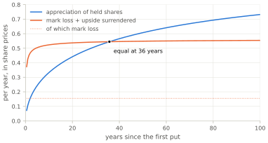
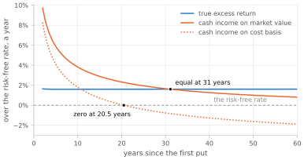

# Returns and Capital {#sec:returns}

What does the wheel earn, and on how much money? All quantities below are per unit of the current share price, so "capital of 11.59" means eleven and a half times what one share costs today, and an income of 0.77 means three quarters of a share price per year.

## What comes in

Take the Standard regime at a thirty-year horizon, which by [the inventory section](#para:inventory-window-average) means 11.40 lots held on average. Cash arrives from three places:

    put premiums      0.1591 per year     one put a week, at 0.31% each
    call premiums     0.3706 per year     11.40 lots, each selling a call every four weeks
    dividends         0.2422 per year     δ_net on 11.40 lots at today's price
    ------------------------------------
    Track A income    0.7718 per year    {#eq:income}

Three quarters of a share price per year, in cash, realized. It is an impressive-looking number, and it is the number that makes this strategy popular. Note also what the composition says: **the calls out-earn the puts more than two to one**, and the dividends out-earn the puts as well. The strategy is named after selling puts, but by the time it is running at scale, put premium is its smallest cash source.

The number is also, on its own, meaningless. It says nothing until we ask what had to be tied up to earn it.

## What is tied up

Two different quantities can be called "the capital", and choosing between them decides the answer.

**Cost basis.** Each lot cost its strike, less the premium of the put that delivered it. That strike is the lot's frozen call strike K_c, and against today's price it is K_c/S = e^x by [eq:depth-def](#eq:depth-def): a lot at depth x cost e^x of today's share prices. Summed over the 11.40 lots, the bases come to 18.04 — 1.58 share prices a lot on average — and the margin on the live put brings the total to **18.23**. This is the number a spreadsheet of purchases produces, and it is what practitioners usually mean by "capital deployed".

**Market value.** Those same shares would sell today for what the market pays, which is one share price a lot whatever the lot cost: 11.40 share prices. The same margin on the live put brings the total to **11.59**.

The margin is in both totals, so the gap between them — 6.6 share prices, or 0.58 a lot — belongs to the lots alone: it is the accumulated paper loss on the standing inventory. It is large because a lot's cost grows exponentially with its depth, which hands the deep lots most of it: those more than 50 log-points down are 28% of the book by [the inventory section](#para:census-thirty-years)'s census, and account for 73% of the gap.

The right choice for measuring *return* is market value, and the reason is worth stating carefully because the other choice is so tempting. Capital committed means capital that could otherwise be doing something else. A share bought at 100 and now worth 60 does not commit 100 to the strategy; it commits 60, because 60 is what selling it would release. The other 40 is gone — it is a loss that has already happened, not an ongoing commitment. Charging opportunity cost on it counts the same loss twice: once when the price fell, and again every year afterwards.

This is also what [the strategy section](#sec:strategy) promised — Track B was defined as capital at market prices — and it is the definition that survives the consistency test in [the verification section](#sec:verification), which the cost-basis version fails.

In symbols, the capital a return is measured against has two terms: γ_p·k, the margin standing behind the one live put — the broker's fraction γ_p of its strike k — and E[I], the inventory at one share price a lot:

E[Capital]  =  γ_p·k  +  E[I]    {#eq:capital}

At thirty years that is the 11.59 above, and it is the denominator of every return in this section. The next subsection turns to the numerator.

## What Track A leaves out

Track A, the cash ledger of [the strategy section](#para:track-a), books premiums and dividends as income and treats buying and selling a lot as swapping cash for shares at the strike, so neither assignment nor call-away registers as a gain or a loss. It is what a brokerage statement shows, and its 0.77 is the obvious candidate for the numerator. A strategy built from short options is exactly where such a number should not be taken on trust. [Goetzmann and colleagues](#ref:goetzmann-et-al-2007) show that the standard summary statistics of investment performance can be *manufactured* by option-writing overlays of this kind — that a strategy can be built to score well on them without earning anything — and characterize the measures that cannot be gamed this way. A cash yield is cruder than any of those statistics, since it does not mark the position to market at all.

Cash accounting is internally consistent, but it is not a return, because two real economic events pass through it without leaving a trace.

**The mark loss at acquisition.** A lot is bought at the strike while the market offers less. That difference is a loss the moment it happens. Track A calls it "acquisition at the operator's chosen basis" and books nothing. Each arrival pays K for something worth S′, a loss of K − S′, and like every flow in this ledger it is measured against the money the trade started from: the price S the put was sold at. Since S′ = S·(1 − d), with d the fall from the sale price, the loss per unit of S is k\* − (1 − d), and at λ arrivals a year

L_acq  =  λ · E[ (K − S′) / S ]  =  λ · ( k\* − 1 + E[d] )  =  **0.1553** per year    {#eq:mark-loss}

the average fall E[d] being [eq:d-mean](#eq:d-mean)'s.

**This is the answer to the slogan [the introduction](#sec:introduction) declined to argue with.** *Assignment just means buying a good company at a discount* — and there is a discount: the strike is set 2.3% below the price on the day the put is sold, so the shares are bought for less than they cost when the trade was placed. What the slogan leaves out is when the purchase happens. A put is assigned only if the price has fallen below the strike by expiry, so on the day the operator buys, the strike is above the market — by 1.5% of the price the put was sold at, on average — and the number above is that overpayment, summed over every assignment and booked on the day it happens rather than deferred into a cost basis nobody marks. A sixth of a share price a year, on this book, is not a rounding on the way to owning something cheaply; it is comparable to the entire put premium the strategy collects. [Israelov and Nielsen](#ref:israelov-nielsen-2014) take the same slogan apart directly. The strike was chosen; the price was not.

**The upside surrendered at call-away.** When a lot is called away, the shares are delivered at the strike while the market is *above* the strike — that is precisely why the call was exercised. The operator hands over something worth more than what they receive. Track A sees an exit at the same price as the entry and books nothing. A lot leaves once, at the first call expiry that finds the price at or above its strike — after J periods, in [the holding-time section](#sec:holding)'s notation — and stands then at a depth x_J ≤ 0: it delivers a share worth S_T, the price at that expiry, for its strike K. Measured against the price S the lot's last call was sold at, the upside it gives up is (S_T − K)/S, and at λ arrivals a year

L_call  =  λ · E[ (S_T − K) / S ]  =  **0.3875** per year    {#eq:giveaway}

The average runs over every way a lot's price can reach that one exit, and the model takes it a call period at a time: the chance a lot is still held at period j and called at its end, times what it gives up when it is, summed over j. To first order the cost is −x_J, the overshoot of [eq:wald-holding](#eq:wald-holding), how far past its strike a lot stands on the first day it is allowed to leave, so this is the call-grid tax again, paid in price rather than in time: 3.9% of a share price for each lot called away. That is more than twice the put premiums, and it will turn out to be the largest negative term in the whole ledger. That ranking is not peculiar to this model: [Hill and colleagues](#ref:hill-et-al-2006), decomposing the returns of a fixed-strike covered-call programme into its component parts, likewise found that *"the cost of exercise ate away the largest proportion of the excess returns."*

Against those, one real gain is also invisible to Track A: the **appreciation of shares held**, which is simply the inventory drifting at the price's own rate, E[I]·m — for 11.40 lots at m = 4.5%, **0.5128** a year.

Add all three, at the thirty-year horizon the section has used so far:

    appreciation of held shares    +0.5128
    mark loss at acquisition       −0.1553
    upside surrendered             −0.3875
    -------------------------------------
    net                            −0.0300

The gain Track A ignores and the two costs it ignores nearly cancel. That is a property of the horizon, not of the strategy, and figure [fig:hidden-terms](#fig:hidden-terms) shows it. The two costs arrive at almost their full rate within a few years — every lot takes its mark loss the day it is assigned, and the fast lots are called away within weeks — while the gain accrues on whatever is held, and so grows only as the book does. At five years the costs are twice the gain and the net is −0.26 a year; the curves meet at about thirty-six years; by fifty the gain is ahead.

{#fig:hidden-terms}

Only where the curves meet do the cash ledger and the economic one agree, so everywhere else the economic profit has to be assembled in full:

E[Π]  =  Track A income  +  E[I]·m  −  L_acq  −  L_call    {#eq:econ-pnl}

At thirty years that is Track A's 0.7718 less the 0.0300 above: 0.7418 a year. What remains is the comparison [the strategy section](#eq:excess-return) set up: charge the capital of [eq:capital](#eq:capital) the risk-free rate it could have earned elsewhere — Track C — and divide what is left by that capital.

**True excess return  =  ( E[Π] − r · E[Capital] ) / E[Capital]  =  (0.7418 − 0.05 × 11.591) / 11.591  =  +1.40% per year**    {#eq:excess}

The wheel earns 1.40 points a year more than the risk-free rate on the capital it ties up — at thirty years, for the figure depends on the horizon. Worked the same way it is 1.23% at five years, 1.31% at ten and 1.46% at a hundred: it rises as the book ages, for two reasons. A lot is a share with a call sold against it, and the call gives away part of what the share would earn — a large part while the price sits near the strike, almost none once the price has fallen well below it, where the call is unlikely ever to pay. A young book is mostly lots near their strikes; an old one holds more lots sunk deep, whose calls no longer offset their shares, so more of its capital earns what the stock earns. And the margin behind the one live put, which is charged the risk-free rate and earns nothing, weighs less on a larger book. The benchmark subsection below returns to both. Track A's reading moves the other way: at five years the three hidden terms take 0.26 a year off its 0.61, and its cash measured against market-value capital reports +5.9%, meeting the economic figure only near thirty-six years. The next subsection sets the horizons side by side, together with what an operator's own records would show.

## The two ledgers, side by side

Two ledgers have now been built for the same book: the economic one, which marks every lot at today's price, and Track A's cash, which is what a brokerage statement adds up to. The table sets them side by side for both regimes at three horizons, each column an average over the first five, ten or thirty years, as in [the inventory section](#para:inventory-window-average). The top four rows are the book and what it ties up. The lots held are E[I] of [eq:little-finite](#eq:little-finite), averaged over the window. The capital they commit is counted two ways: at market value by [eq:capital](#eq:capital), and at cost basis, where each lot counts at what it cost, e^x of today's price by [eq:depth-def](#eq:depth-def). The equity the account must actually hold is γ_p·k + γ_s·E[I]. The bottom three rows are returns over the risk-free rate, each differing from the one above it in one respect: the economic one of [eq:excess](#eq:excess) on market value, Track A's income of [eq:income](#eq:income) on the same market value, and Track A's income on cost basis.

| | 5 y | 10 y | 30 y |
|---|---|---|---|
| *Standard regime, p\* = 20%* | | | |
| lots held | 5.41 | 7.39 | 11.40 |
| capital, market value | 5.61 | 7.59 | 11.59 |
| capital, cost basis | 6.70 | 9.83 | 18.23 |
| equity required, at portfolio margin | 1.55 | 2.04 | 3.04 |
| **true excess return** | **+1.23%** | **+1.31%** | **+1.40%** |
| cash income on market value | +5.88% | +3.82% | +1.66% |
| cash income on cost basis | +4.11% | +1.81% | −0.77% |
| *Conservative regime, p\* = 10%* | | | |
| lots held | 2.63 | 3.58 | 5.50 |
| capital, market value | 2.82 | 3.77 | 5.70 |
| capital, cost basis | 3.35 | 4.86 | 8.90 |
| equity required, at portfolio margin | 0.85 | 1.09 | 1.57 |
| **true excess return** | **+1.01%** | **+1.14%** | **+1.28%** |
| cash income on market value | +5.41% | +3.53% | +1.52% |
| cash income on cost basis | +3.76% | +1.62% | −0.83% |

The true excess return rises with the horizon in both regimes, for the reasons the previous subsection gave: Standard's from 1.23% to 1.40%, Conservative's from 1.01% to 1.28%. What it should be measured against is the next subsection's question, and why Conservative trails Standard, by less the longer the book runs, is answered under the Conservative regime further down.

The cash-on-cost-basis line does something else entirely, and it is worth understanding because **it is what an operator's own records will show them**. Early on it is spectacular — a strategy apparently earning 4.1% over T-bills. Then it decays, crosses zero around year twenty, and keeps falling, while the economic return rises; figure [fig:two-ledgers](#fig:two-ledgers) draws all three lines. The cash-on-market-value row — the same cash, measured against market value instead of cost — separates the two things wrong with the cash-on-cost line. At five years nearly all of the error is in the numerator: cash on market value reads 5.9% against an economic 1.2%, for the reason the previous subsection gave, and cost basis takes back only 1.8 points of it. By thirty years the numerator has nearly come right — cash on market value reads 1.7% against an economic 1.4% — and most of the error is the denominator: cost basis has inflated to 1.57 times market value as deep lots accumulated, and dividing by it turns 1.7% into −0.8%. An operator watching this happen will conclude the strategy has stopped working. It has not; the measurement was wrong at both ends, too flattering at the start and too damning later, and for a different reason at each.

{#fig:two-ledgers}

**The equity row is not a rival to the two capital rows.** An operator does not have to *have* 11.59 in order to hold 11.59, because a broker will lend against held shares. At portfolio margin, γ_s = 0.25, the operator must keep a quarter of the shares' market value in the account, plus the whole margin behind the live put, which the broker does not lend against at all: **3.04** at thirty years in the Standard regime. Because the put's margin is posted in full, the equity required is a little over a quarter of the market-value capital — 26% of Standard's at thirty years, and up to 30% of Conservative's at five, where the same margin stands beside a smaller book. It is a second ledger line rather than a third measure of capital: it answers "what must be *in* the account?", where the two capital rows answer "what is committed?". A return is not divided by it, because the resulting number is a fact about financing rather than about the strategy; the subsection on leverage below works out what happens to an operator who tries, and what the borrowing itself costs. How much of the wheel a given balance can run — the question the equity row does answer — is worked out in [the constrained section](#sec:constrained).

Of the table's three returns, then, only the first measures the strategy. The other two are what an operator's own records produce: cash on market value agrees with it only near thirty-six years, and cash on cost basis is too flattering early and too damning late, for a different reason at each end. The equity row is not a return at all but the money the account must hold. What remains is one figure per regime and horizon — 1.40% a year over the risk-free rate at thirty years in the Standard regime, a little less in the Conservative and less again over shorter horizons — and whether that is a good result depends on what it is set against, which is the next subsection's question.

## The benchmark that matters

The 1.40% is measured against T-bills, and T-bills are the wrong comparison. This strategy keeps almost all of its capital in shares — 98% at the thirty-year mark — so the question an operator actually faces is not whether it beats cash but whether it beats putting the same money in **the stock**.

Buying and holding the same stock earns μ − r − w·δ = **+1.625%** over the risk-free rate: its 7% expected return, less the 5% risk-free rate and the withholding tax w = 15% takes from its 2.5% dividend. Not all of the wheel's capital is in shares, though — the rest is the margin standing behind the live put. Held in the same proportion, 96.5% in the stock at five years and 98.3% at thirty with the rest in cash earning r, buy-and-hold earns:

| Standard regime | 5 y | 10 y | 30 y |
|---|---|---|---|
| the wheel | +1.23% | +1.31% | +1.40% |
| the same capital in the stock | +1.57% | +1.58% | +1.60% |
| **difference** | **−0.33%** | **−0.28%** | **−0.20%** |

At fair option prices, then, the wheel earns less than the same money in the stock: a fifth of a point a year at thirty years, a third of a point at five. The options are not what costs it; the exposure is. A lot is a share with a call sold against it, and the call takes back part of the share's exposure to the stock — most of it while the price sits near the strike, almost none once the price has fallen well below it. The book is therefore a smaller position in the stock than the shares it holds.

> **Detour: delta, and what an option is expected to earn.** An option's *delta* is how far its price moves when the share's price moves by one: about a half for a call struck at the money, close to zero for one far out of the money, close to one for one deep in it ([Hull](#ref:hull)). A share with a call sold against it moves by one less the call's delta, and a short put moves with the share by the put's delta, so the sum over a book is the number of shares it behaves like. In the Black–Scholes setting this article prices every option in, a position's expected return above the risk-free rate is its delta times the share's. Delta is therefore the size of the stock position a book is equivalent to, as far as expected return goes; risk is another matter, taken up in the next subsection.

Counted by delta, together with the short put, the book carries **87.5%** of its capital in stock exposure at five years and **93.2%** at thirty — not the 96.5% and 98.3% in shares. Against the stock scaled to that exposure instead, the gap all but closes:

| Standard regime | 5 y | 10 y | 30 y |
|---|---|---|---|
| the stock, scaled to the book's delta | +1.42% | +1.47% | +1.52% |
| the wheel, minus it | −0.19% | −0.16% | −0.12% |
| …with the collateral credited, as below | −0.01% | −0.03% | −0.03% |

**At fair option prices the wheel is economically a smaller position in the stock.** Per unit of the exposure it actually carries it earns what the stock earns, short only of the tax withheld on dividends from shares whose exposure its calls have sold. Its calls sell part of that exposure away at a fair price, and the shortfall against the same capital fully invested in the stock is the return on the exposure sold.

> **A footnote on the collateral, which Track C overcharges.** Track C charges r against everything in Track B, and Track B includes the γ_p·k of margin standing behind the live put. But that margin is a *hold* on the account, not a payment: the cash behind it sits at the broker earning approximately r, which is the whole point of calling the trade a cash-secured put. The model credits it nothing while charging it r, so it overcharges by r·γ_p·k a year — **17 basis points of capital at five years, 13 at ten, 8 at thirty**, the share falling as inventory grows around a margin requirement that does not. The correction lifts the wheel and not either benchmark, whose cash side already earns r by construction: the gap to the same capital in the stock narrows to **−0.16 points** at five years and **−0.11** at thirty, and the gap to the stock scaled to the book's delta to the two or three basis points of the table above. That is still nothing that moves a verdict — half a point of implied volatility is worth more than the entire correction — which is why it is recorded here rather than built into the ledger. Two further remarks. An operator who actually posts the full strike in cash rather than margin has the same overcharge about **4.7 times** larger at thirty years, because the collateral is k rather than γ_p·k. And this is arithmetic, not a measurement: the overcharge is r·γ_p·k over the capital of [eq:capital](#eq:capital), so it needs no estimate and carries no uncertainty.

This result is what a no-arbitrage argument would have predicted before any of the machinery was built. Selling a fairly priced option is a fairly priced transaction. Doing it repeatedly, in a loop, with inventory, is still a fairly priced transaction. **The three quarters of a share price per year that Track A reports is not income the strategy generates. Most of it is the risk-free rate the capital would have earned anyway, and the rest is the stock's own premium on the exposure the book carries, relabelled — and while the book is young, part of it is the operator's own capital handed back in instalments.**

The per-lot accounts make the same point in miniature: over its lifetime a lot collects **3.72%** of a share price in call premiums and surrenders **3.90%** in upside at call-away. The covered-call leg, the part that feels most like free income, costs a lot 0.18% of a share price over its life: the stock's premium on the exposure its calls hand over.

Nor is this only what the present model finds. [Israelov and Nielsen](#ref:israelov-nielsen-2014) arrive at the same conclusion by a decomposition close to the one above — splitting a covered call into an ordinary equity position plus a short-volatility position — and state it almost in these words. In their worked example, priced so that implied volatility matches the volatility that follows, *"even though the annual collected option premium is 22.1% of net asset value, there would be zero compensation for shorting volatility,"* leaving a programme *"no different from what would have been earned by simply reducing the index position size by 51%."* Different instrument, different accounting, different decade; same answer.

What the machinery *does* determine is everything other than the mean: how much capital is required to run the strategy, how long it stays committed, how large the inventory grows, and under what conditions the whole thing stops resolving. Those are not small questions — they decide whether the strategy is operable — but they are questions about capital and risk, not about return.

## Identical in return. Not identical in risk.

Equal expected returns invite the obvious follow-up: equal *how*? Two strategies can earn the same average and feel nothing alike, and this is a case where they do not.

> **Beta, up and down.** A position's beta is how much of the market's move it takes: beta 1 means a 10% fall in the stock costs 10%, beta 0.5 means it costs 5%. A single number assumes the position responds the same way in both directions, which is exactly what an option position does not do. Splitting it — measuring the response to rising prices and to falling prices separately — is standard practice for option strategies, and for this one the two numbers are very far apart.

Measured over one call period against the depth census, the shares the operator holds have an **up-beta of 0.83 and a down-beta of exactly 1.00**.[^returns-beta]

That second number is not a rounding. It is exact, in every configuration, for a reason visible in one line: a lot still in inventory is a lot below its call strike, and below its strike a covered call is *pure stock*. The call expires worthless, the share falls the whole way, and nothing about having sold the call changes it. **Covered calls do not provide downside protection.** The premium is a cushion, but it is one period's premium against the entire decline, and the model prices the cushion at exactly what it is worth and no more. This is the most widely repeated claim made for the strategy, and the article's own machinery contradicts it without needing any data.

**And inventory is not the whole book.** The operator is also short a live put, which loses when the stock falls — so the total position is more than fully exposed on the downside. Shocking the whole book and marking it gives, per unit of capital committed:

    price shock        −20%    −10%      0     +10%    +20%
    book exposure      1.07    1.07    0.93    0.75    0.61

**The wheel is more exposed to a fall than the stock is, and less exposed to a rise.** Almost exactly one full share of that downside excess is the short put; the rest is inventory whose calls have gone so far out of the money that they no longer offset anything.

The middle of that row is the more interesting part, because it is not a static number — it is the position *changing character as prices move*. As the stock falls, every frozen call slides further out of the money and each lot reverts toward being plain stock; as it rises, the calls come alive and the exposure drains away. The strategy therefore buys exposure into declines and sheds it into rallies, automatically and without anyone deciding to. [Israelov and Nielsen](#ref:israelov-nielsen-2015) name this **equity reversal** and attribute about a quarter of a covered call's total risk to it, at a Sharpe ratio near 0.10 — which is to say it is a real risk that is paid almost nothing. The model agrees for a reason it can state exactly: under the price process assumed here such an exposure *cannot* be compensated, so the machinery assigns it no return at all. It is risk taken for free — and when [the same decomposition is run across eleven national equity indexes](#ref:israelov-covering-the-world), the exposure's return is statistically indistinguishable from zero in every one of them.

Which lever controls it? Not the strike dial: at the Conservative setting the up-beta moves from 0.828 to 0.824, which is nothing. It is **n**, the number of put periods a call is written across:

    calls written every…      1 put period   4 periods   13 periods
    up-beta                       0.93          0.83         0.68

That is [the holding-time section](#sec:holding)'s call-grid tax arriving a second time. There, freezing a strike for four weeks while puts are written weekly cost holding time; here the same freeze costs *upside*, and for the same reason — the longer a strike stays fixed, the further the stock can run away from it before anyone resets. One lever, two consequences, and the article has been drawing only the first. Higher volatility, counter-intuitively, *reduces* the asymmetry: at σ = 30% the up-beta rises to 0.87, because lots run deeper and their calls sit further out of the money.

> **A caution about comparing this with published numbers.** The Cboe buy-write index has published split betas — [Israelov and Nielsen](#ref:israelov-nielsen-2015) put them at **0.46 up and 0.85 down** — and the temptation is to set the 0.83 above beside the 0.46 as a like-for-like comparison. It is not one, and the reason is worth measuring rather than asserting. Run the estimator used here on that index's own construction, a plain at-the-money covered call rewritten every month, and the up-beta comes back at **0.00**. That is not a failure of either measurement: a payoff kinked exactly at the strike gives away the whole of every rise, and no slope can describe it. Conventions do the rest of the work. Measuring returns on calendar months while the options expire mid-month makes each period straddle two strikes and average across the kink, which alone lifts the up-beta to about **0.16**; setting the strike at the first listing *above* spot leaves a sliver of upside unsold and takes it to about **0.29**; the published figures use a third convention again, overlapping twenty-one-day returns. **Three choices about how to measure, none of them a difference in the risk being measured, span nearly half a unit of beta** — which is more than the entire asymmetry either book displays. The downside is the reassuring half: their 0.85 and this estimator's 0.83 on the same construction agree closely, because a kink at the strike does not bite on the way down. **The figures above describe this book on this estimator, and are not comparable with a published beta.**[^bxm-beta]

## The leverage that survives does not pay for itself

Everything so far is an unlevered account, earning [eq:excess](#eq:excess)'s +1.60% on capital the operator owns outright. Borrowing changes the arithmetic in exactly one place. Equity earns the strategy's excess on every share it carries and pays the financing spread on the part that was borrowed — the risk-free leg of the carry is already what "excess" is measured against — so for a book of leverage L financed at r_b:

net excess on equity  =  excess · L  −  (r_b − r) · (L − 1)    {#eq:levered-excess}

Read as an equation in the spread, that gives the whole result at once. The two terms cancel for **every** L when r_b − r = excess: borrowing is exactly neutral, in whatever quantity, when the broker's spread equals the strategy's own excess return. The break-even spread, in other words, *is* the excess return — **1.60%** here, [eq:excess](#eq:excess)'s own number rather than a coincidence resembling it. Retail financing spreads of 1–3% straddle it, and above it leverage does not merely stop helping: it subtracts.

The tempting reading is the two-ledger table's equity row. An account holding the thirty-year book on the broker's minimum equity of 3.04 is levered **3.81 times**, and at no spread at all [eq:levered-excess](#eq:levered-excess) reports **+6.11%** — close to four times the excess return, which is exactly the appeal. Two things happen to it. Financing eats it: at a 1.5% spread it is **+1.90%**, twenty-nine basis points of extra return for nearly four times the exposure, and at 3% it is **−2.31%**. And nobody holds that book anyway, because [the constrained section](#sec:constrained)'s barrier sits **1.7% below today's price** at that leverage — the account is sold out on the first bad afternoon, with an eventual probability of **97.9%**. So the four-times number is not a return an operator collects. It is a return they are liquidated out of.

The number worth computing is therefore the one at leverage that survives, which [the constrained section](#sec:constrained) puts at L_max = **1.1349** at portfolio margin and a 10% eventual-liquidation tolerance. Across every account type:

| net excess on equity | fully paid | Reg T | portfolio margin | aggressive PM |
|---|---|---|---|---|
| survivable leverage L_max | 1.0000 | 1.0861 | 1.1349 | 1.1557 |
| financed at r (spread 0) | +1.60% | +1.74% | +1.82% | +1.85% |
| spread 1.5% | +1.60% | +1.61% | +1.62% | +1.62% |
| spread 3.0% | +1.60% | +1.48% | +1.42% | +1.39% |

**The borrowing that survives the liquidation constraint is too small to pay for itself at any retail financing rate.** At the keenest of them — a spread of 1.5% — the whole ladder collapses onto +1.61% to +1.62%, within two basis points of the unlevered +1.60%; at 3% every levered account earns *less* than the unlevered one. Even financed at the risk-free rate itself, the entire effect is 22 basis points at portfolio margin and 25 at the most aggressive margin available. And the real effect is smaller still, because an account does not sit at its ceiling: [the constrained section](#sec:constrained) measures the prudent account's realized leverage at **0.745** against a permitted 1.1349, a book refilled one lot a week being under its stopping rule most of the time. Most of the time there is no debit to pay a spread on, and no multiple to collect.

The same verdict arrives in the only currency an operator actually spends. [The constrained section](#sec:constrained) computes the largest draw compatible with a fixed liquidation risk, and it is **4.63% of equity unlevered against 4.58% at survivable leverage** — flat to a few basis points as far as the leverage that survives, then collapsing through zero beyond it. Borrowing that survives buys no drawing power either. Two cautions travel with that figure, both that section's: it holds the *liquidation risk* constant rather than the account, and the draw that keeps the *business* stationary is **2.12% of equity a year** — two numbers both called sustainable, a factor of two apart.

None of this touches the verdict of the previous subsection, and the reason is that [eq:levered-excess](#eq:levered-excess) does not know what the capital is invested in. The same loan, at the same spread and against the same barrier, is available to someone who buys the shares and sells no options at all, so both sides of the wheel-against-the-stock comparison are multiplied by the same L and charged the same spread. The spread cancels between them exactly, and what is left is the unlevered gap multiplied by L: it *scales*, and does not change sides. At each account type's own survivable leverage it runs from 0.7 to 0.8 basis points against 0.7 unlevered — **+0.01% at every γ_s**, the same one basis point of numerical noise as before. **Leverage multiplies the wheel and the stock identically, so it cannot decide between them.**

(One reconciliation, for a reader who checks this against [the constrained section](#sec:constrained)'s own return-on-equity column, which reads +1.90% where the table above reads +1.82% at the same leverage. That section excludes the put collateral from both sides of the ledger, uniformly, and so levers an excess of 1.68% rather than this section's 1.60%. The 8-basis-point difference between them is the collateral overcharge of the footnote above, and nothing else.)

## So where could an edge come from?

Not from borrowing, then. Only from options being priced richer than fair. That is not a hypothetical: implied volatility exceeds subsequently realized volatility systematically, and this **volatility risk premium** is the documented source of return in every put-write and covered-call study.

But the size a reader is likely to have met is the wrong one for this strategy, and the gap between the two is worth stopping on. The premium is usually quoted at two to four volatility points, and those are *index* figures — measured on options on the S&P 500, which is where both the studies and the tradable benchmarks live. [Bakshi and Kapadia](#ref:bakshi-kapadia-2003-jod) measured index and single names side by side on the same footing and found 3.3 points on the index against **1.5 across twenty-five large individual companies** — 1.07 once the contracts with a dividend before expiry are set aside. This strategy writes options on one company at a time, so the single-name number is the one it is entitled to, and **the prize is about a point rather than three**.

The reason the two differ is not a quirk of measurement, and it is the more useful half. What option buyers are paying up for is protection against *the market* becoming more turbulent — and most of any one company's volatility is its own, which nobody needs insurance against because holding a few dozen names washes it out. That is exactly what the evidence shows: Bakshi and Kapadia found a firm's hedged option returns track market volatility and are unrelated to the firm's own, and [Carr and Wu](#ref:carr-wu-2009), measuring a different quantity over a later decade, found the premium a name earns is proportional to its exposure to market variance with nothing left over for a name that has none. An index option bundles in the one thing a single name cannot sell: the risk that everything falls together. Selling options on one company collects the smaller, unbundled half — which is [the portfolio section](#sec:portfolio)'s problem as much as this one's, because a book of single names is paid the single-name premium and still carries the market's risk when correlations rise.

None of which means the single-name premium is absent. Implied exceeded realized for twenty-three of Bakshi and Kapadia's twenty-five companies, so it is small and pervasive rather than large and concentrated. This article assumes it away anyway — σ_IV = σ throughout — and that assumption can now be priced instead of merely declared: it gives up about a point, in the direction that makes every headline result below a floor rather than a forecast.

The model can price exactly how much of it is needed. Holding everything else fixed and raising only the volatility at which premiums are quoted:

| σ_IV | premiums/yr | wheel | vs buy-and-hold |
|---|---|---|---|
| 20.0% (fair) | 0.5297 | +1.60% | +0.01% |
| 20.5% | 0.5555 | +1.83% | +0.23% |
| 21.0% | 0.5818 | +2.05% | +0.46% |
| 21.5% | 0.6086 | +2.29% | +0.69% |
| 22.0% | 0.6358 | +2.52% | +0.92% |

**The break-even is zero.** At fair prices the wheel matches the stock, and every volatility point of overpricing is worth about 45 basis points of excess return on top. There is no hurdle to clear first: against the single-name premium of roughly a point that the literature actually supports, **the whole of it is edge — some 50 to 70 basis points a year**, the two middle rows of the table. That is a cleaner statement than it looks, and it is the no-arbitrage argument showing up as arithmetic — a fairly priced loop earns exactly what the asset earns, so whatever the strategy makes above that has to come from the options being sold dear.

The same table is also the clearest way to see what the familiar number would have bought. At the two to four points the index studies report, the wheel would clear 90 to 180 basis points over simply holding the stock. Nothing in the model differs between those two readings — only the input does, and reaching for the number everyone quotes would overstate the prize by a factor of three.

The natural objection to *every point is worth about 45 basis points* is that surely something eats part of it on the way through — that a machine with this many moving parts must skim off some of any extra richness before it reaches the owner. It does not, and the claim does not rest on this model alone. Israelov and Nielsen's example, built at a quite different ratio of option notional to capital, likewise has the whole of the richness arriving rather than a fraction of it. And the experiment has been run on real prices: [Merton, Scholes and Gladstein](#ref:merton-scholes-gladstein-1978) simulated fourteen years of covered call writing across a hundred and thirty-six stocks, then re-ran the entire simulation with the premium received scaled from 70% to 130% of model value, and [repeated the exercise on puts four years later](#ref:merton-scholes-gladstein-1982). Their dial is percent-of-premium where this one is volatility points, but at the premium levels they report the two convert cleanly — ten percent of an at-the-money six-month premium is about three volatility points — and their measured slopes then come to roughly **50 basis points per volatility point per year on each leg**, against the 45 here. Two legs, a different era, real price paths.[^msg-slope]

They also report the other half of the claim, which is easy to overlook: across that whole 70%-to-130% range the standard deviation of the outcome is *"virtually unaffected"*. Richer options move the return and leave the risk where it was. That is what makes a volatility premium worth having rather than merely worth measuring, and it is the same statement this section's table makes one column at a time.

## The premium is real. It also does not arrive.

That table invites a straightforward conclusion — find a few points of overpricing and collect 45 basis points apiece — and the live account is the reason to resist it. Inverting the option premiums that account actually paid and comparing them with the volatility that actually followed, the puts it sold were indeed dear, by rather more than the single-name studies above would lead one to expect. That comparison is looser than it sounds, and [the live section](#sec:live) is where it is made properly: those studies measure options struck near the current price, while this operator sells well below it, and those are different places on the same volatility surface. Its option overlay nevertheless earned **nothing**: measured against simply holding the same shares over the same days, the entire apparatus of puts, assignments, calls and call-aways came to zero within the precision eighteen months can support.

The two facts are not in conflict, and the reconciliation is the most useful thing in this section. A rich put is rich because it is likely to be assigned into a falling stock, and the premium is collected in the same transaction that hands the operator a lot below water. Of every dollar of put premium the live account collected, the mark loss taken at assignment consumed about four fifths. And the fifth that survives on the put leg is more than given back on the call leg, which finished behind by about half of the premium it collected. **The volatility risk premium is real, and it is very nearly the price of the inventory it creates.**

Two things follow for reading the table above. It is a *comparative static* — it holds the entry policy fixed and asks what a richer quote is worth — and so it correctly prices a spread that arrives without a matching change in assignment. It is not a promise that a measured spread converts at 45 basis points a point, because the spread that is easiest to measure is the one on far-out-of-the-money puts, and that one is quoted precisely because those puts are not as far out of the money as they look.

## What the single σ_IV leaves out

One number stands in for the entire volatility surface here, and the simplification should be named rather than left implicit, because a real surface is not flat in either direction that matters to this strategy.

**Across strikes.** The puts the operator sells carry a fatter implied volatility than the calls they sell — the skew of [the introduction](#sec:introduction)'s detour. So the edge concentrates in the put leg and in shallow lots, while deep lots, which are most of the inventory, contribute little regardless. In the live account the axis that matters turns out to be the strike rather than the leg. Measured over the trading days its contracts actually ran, options near the money were quoted within a fraction of a point of the volatility that followed — on both legs alike — and the spread widened the further out the strike sat, reaching about five points on puts 5–10% below spot against under one on calls the same distance above. The put leg looks dearer partly because the operator sells it further out; at matched distance it still runs three to five points above the call leg's, and that is the skew itself. Splitting σ_IV into two numbers would capture this and is a small change; it is not made here because it buys detail in a quantity the article has already deliberately set to zero.

**With depth.** The more interesting omission. A lot is deep because its stock fell, and a stock that has fallen is quoted at a higher implied volatility — so the model, holding σ_IV fixed, understates what deep lots earn on their calls. The live account confirms the direction: calls written against its deepest lots were quoted materially dearer than calls on its shallow ones. But most of that gap is not depth at all — deep lots sit on names that are volatile to begin with, and once each name is compared against its own typical level, the genuine depth effect is roughly a third. **That is why it is left out: a third more implied volatility on the smallest income term in the ledger, measured across a few dozen contracts, is not worth carrying a strike- and state-dependent volatility surface through every formula in this article.** It is recorded here as a known bias, and its sign is favourable — the model is, in this one respect, pessimistic about deep inventory.

**Across tenor.** A real surface is not flat in maturity either, and this is the axis the running example straddles: weekly puts written against four-week calls. Short-dated options are normally quoted *cheaper* in volatility terms than longer-dated ones — the shape a reader may recognize as the VIX term structure in contango, where the nine-day index sits below the thirty-day one. If that holds, a single σ_IV **flatters the put leg relative to the call leg**, and by more than either of the two axes above: the live account's own contracts, read on a trading-day clock, put its weekly puts near 29% implied against roughly 33% on its four-week calls. Some of that gap is moneyness rather than tenor, since the two legs sit at different distances from the money by construction. But the direction is the one the term structure predicts, and it falls on the leg the strategy leans on. **This is the omission with the best claim to being first-order**, and the next subsection is what makes it matter.

And a fourth, which no surface captures: the edge is paid on premium volume, which is largest exactly when inventory is shallow and smallest when it is deep.

## The one dial the model says is free

The three omissions above are all about *which* option is written. The remaining question is *how often*, and here the model returns an answer sharp enough to be uncomfortable. Holding the call period at four put periods and sweeping the absolute cadence over a thirteenfold range:

    cadence              weekly  biweekly  monthly  quarterly
    puts written / yr      52.0      26.0     12.0        4.0
    lots acquired / yr    10.40      5.20     2.40       0.80
    lots held             11.40      8.02     5.42       3.09
    capital (market)      11.59      8.21     5.61       3.28
    true excess          +1.60%    +1.59%   +1.56%     +1.47%
    vs buy-and-hold      +0.01%    +0.00%   −0.01%     −0.07%

**Thirteen basis points across a thirteenfold change.** Writing thirteen times as many contracts does not earn thirteen times as much, or twice as much, or measurably more at all: the return per unit of capital is the same, and what cadence really sets is **how much capital the position needs** — 11.59 share prices a name at weekly, 3.28 at quarterly. That is the same shape of conclusion the dividend sweep reached, and for a related reason: a faster clock does not create edge, it accumulates inventory faster. What it buys is on the other side of the ledger, and [the portfolio section](#sec:portfolio) is where it is spent — a given balance runs a few names quickly or many names slowly, at the same return.

**The uncomfortable part is that the record disagrees, and the model cannot see why.** Cboe publishes both a monthly and a weekly at-the-money put-writing index on the same underlying, which is this sweep run for real. Over 2006–2018 the monthly programme compounded **5.97%** and the weekly **4.51%** — while the weekly collected **37.1%** of notional a year in premium against the monthly's **22.1%** ([Bondarenko](#ref:bondarenko-2019)). More premium, less money, and a gap of nearly a percentage and a half that this table puts at thirteen basis points with the sign reversed. At a *flat* volatility premium the model even tilts the wrong way, harvesting 45 basis points a point at weekly against 42 at monthly, because premium volume scales as one over the square root of tenor and a flat spread pays on volume.

The reconciliation is the axis named just above. Take the two indices' own premium collections: pure square-root scaling says the weekly programme should gather √(52/12) = 2.08 times the monthly's, and it gathered 1.68 — so it was selling at roughly **0.81 of the monthly's implied volatility**, three points lower at those levels. Three points, at this section's own 45 basis points a point, is the right order to account for the whole gap. **So cadence is not free; it is free in a model whose σ_IV does not depend on tenor.** Giving σ_IV a term structure is the smallest extension that would let this article speak to the question at all, and [the outlook](#sec:outlook) records it as the first thing a practitioner would ask for.

## Dividends, resolved

[The depth section](#sec:depth) left a trade-off open: dividend yield pays carry but slows the climb back to the strike, since at a fixed total return every point of yield comes out of price appreciation. Sweeping the yield with everything else held fixed:

    gross yield δ         0%      1%     2.5%      4%      6%
    ν                  +5.0%   +4.0%   +2.5%   +1.0%   −1.0%
    lots held            8.54    9.56   11.40   13.65   17.31
    capital (market)     8.74    9.75   11.59   13.84   17.51
    capital (cost)      12.11   14.15   18.23   24.00   35.50
    true excess        +1.98%  +1.83%  +1.60%  +1.38%  +1.08%

Yield is **mildly negative for the wheel, monotonically** — but the interesting part is where the damage falls. The return declines by 90 basis points across the sweep, most of which is simply the withholding tax on a larger dividend stream; measured against a buy-and-hold benchmark that suffers the same tax, the gap is essentially zero throughout — never more than two basis points, at any yield. What yield really does is **double the inventory and nearly triple the cost-basis capital**. A high-yield name does not make the wheel much less profitable per unit of capital; it makes the wheel need far more capital, and take far longer to release it.

The δ = 6% row deserves its flag: ν has gone negative there, which by [the holding-time section](#para:when-lots-never-leave) means a fixed fraction of lots never come back at all. Its thirty-year figures are a snapshot of a system that does not converge. [The stability section](#sec:stability) takes that up.

(One convention note, since the conclusion depends on it. Total return is held fixed as yield varies — dividends are treated as a *route* for return, not extra return. Assume instead that a 2.5% yielder returns 2.5% more in total than a non-payer, and the sign flips. The equal-total-return assumption is the neutral one.)

## What if the dividend never falls?

[The depth section](#sec:depth) held δ constant on the grounds that an aristocrat's payout tracks the price trend, and flagged one residual: between raises the payout is fixed in dollars, so the realized yield moves inversely with the price — and since a yield is the *reciprocal* of a price, tracking the trend pins the middle of that yield rather than its average, which sits above δ. The sweep above is enough to price that, and the reason is worth seeing, because it is the whole answer.

δ reaches the model through exactly two channels — the drift ν = μ − δ − σ²/2 and the income δ_net·E[I] — so any story about the yield being effectively higher is a story about running the model at a larger δ. It is a *row of the table above*, not a new model. Writing y for the market's log deviation from the level at which it yielded δ, and taking dividend growth equal to the price's log drift, y is driftless with volatility σ, so a position of age t collects a yield inflated by e^(σ²·t/2) — [the Gaussian lemma](#drv:partial-expectation) again, with the cut-off removed and c = σ·√t. Averaging over held lot-time and solving the fixed point — a larger δ lowers ν, which ages the book, which inflates the yield again:

    horizon                      5 y      10 y      30 y
    inflation factor            1.020     1.039     1.113
    δ_eff                       2.55%     2.60%     2.78%
    true excess               +1.59%    +1.58%    +1.56%
    change from constant δ    −0.01pp   −0.01pp   −0.04pp
    gap vs buy-and-hold       +0.03pp   +0.01pp   +0.01pp

**Four basis points at thirty years, and negative.** The extra carry is real and it is outweighed, by the same two mechanisms the sweep above already identified: a higher yield drags harder on the price, so the book deepens (inventory rises 3.4%, cost-basis capital 5.1%), and a larger share of the total return arrives in the one form that is taxed on the way in.

One warning about that inflation factor, since it is the kind of number a reader might reach for. It corrects a δ defined as the payout over the *trend* price — the yield at y = 0. A δ read off observed dividend yields is not that number: it is already an average taken over whatever deviations the period contained, so the inflation is inside it already. **Applied to a measured yield the factor corrects a number that was never wrong**, and it double-counts by precisely the quantity computed here.

The last line is the one that settles it. The article's verdict is not the wheel's excess return in isolation but its *gap* against owning the stock, and the sweep above showed that gap is flat in δ to a basis point or two. A sticky dividend moves the wheel and the benchmark together, so it cannot change the verdict — and if anything it favours the wheel, since a buy-and-hold position holds one anchor for the entire horizon and picks up a larger inflation factor for it (1.37 at thirty years, against the wheel's 1.11) while the wheel's lots turn over.

Two boundaries mark where this analysis stops.

The inflation factor **has no limit**. Held lot-time thins out like the holding-time tail, e^(−ν²·t/(2σ²)), at 0.8% a year, while the yield inflates at σ²/2 = 2% a year; the second wins, so the average has no stationary value and the correction above is only ever a finite-horizon statement. That divergence is not a numerical defect — it is the model reporting that a payout cannot be assumed fixed forever.

And there is a depth past which the assumption is self-defeating. Freeze the payout in dollars and a lot at depth x faces a yield of δ·e^x on the market value of its shares, so the drag grows with depth and the depth drift becomes ν − δ·(e^x − 1). That changes sign at x\* = ln(1 + ν/δ), and beyond it grows more negative — a runaway region rather than a slow one. At the running parameters x\* sits **50% below the strike**, with 16% of the thirty-year census already past it. It is the Gordon-model price at which a fixed payout stops being payable, which is to say it is the point where a company stops being an aristocrat and starts being [the outlook](#sec:outlook)'s permanent-impairment case. Under the market's pricing drift the boundary is far tighter — 17% below the strike, with 69% of the census beyond it — which is a sharp way of putting the limitation: **option prices are not consistent with a dividend that never falls.**

## The Conservative regime

Everything above, apart from the Conservative rows of the two-ledger table, used p\* = 20%. At p\* = 10% — [the entry section](#sec:entry)'s Conservative setting — with strikes 3.5% out of the money rather than 2.3%:

    lots held 5.50 · capital (market) 5.70 · capital (cost) 8.90
    Track A income 0.371/yr · true excess +1.49% · cash-on-cost −0.83%

Half the assignments, half the inventory, half the capital — and a slightly *worse* excess return than Standard, against a benchmark of +1.57%. The eight-basis-point deficit is worth chasing down rather than interpreting, because it is not economics at all. It is the collateral footnote above, arriving where it is easiest to see. The put margin γ_p·k is essentially the same 0.19 in both regimes — it is one put either way — but the inventory it stands beside is half the size, so the margin runs 3.4% of Conservative's capital against 1.7% of Standard's, and Track C's overcharge doubles with it, from 8 basis points a year to 17. Credit that collateral with the rate it actually earns and the two regimes agree on the number that matters:

| difference vs buy-and-hold | 5 y | 10 y | 30 y |
|---|---|---|---|
| Standard, as modelled | +0.03% | +0.01% | +0.01% |
| Conservative, as modelled | −0.14% | −0.11% | −0.08% |
| Standard, collateral earning r | +0.20% | +0.14% | +0.09% |
| Conservative, collateral earning r | +0.20% | +0.14% | +0.09% |

The last two rows agree to a third of a basis point at every horizon, which is far tighter than either is separately determined. **The entire visible difference between the two regimes is an accounting convention, not a property of the strategy** — and it is a useful reminder that a deficit of a few basis points in a table like this is more likely to be a ledger artifact than a discovery.

That leaves the real result, which is the invariance. The choice of strike moves everything the operator experiences — how often they are assigned, how much capital they need, how large the book grows, how busy the account is — and moves the expected return not at all. It is the tidiest illustration in the article of what the model is for: the dial the operator actually turns is a dial over their own experience of the strategy, not over its returns.

## What this section produced

The section set out to price the strategy and found that at fair option prices there is nothing to price: the wheel is economically the stock. Its whole edge is the volatility risk premium, and the conversion is that **every point of overpricing is worth about 45 basis points of excess return, against a break-even of zero** — no hurdle to clear before the strategy is worth running, and no return available from the machinery itself. The third of a share price a year that Track A reports is the equity risk premium relabelled, plus the operator's own capital returned in instalments.

Three qualifications, none of them small. Identical expected return is not identical risk: the book changes character as prices fall, because every frozen call slides further out of the money as the stock drops away from it. Leverage buys none of the missing return, the spread at which borrowing turns neutral being **1.60%** — the strategy's own excess return rather than a number that resembles it, so that ordinary retail financing straddles the break-even. And the strike dial moves everything the operator lives through while moving what they earn not at all.

One question goes unasked here, and it is the one that decides whether any of these numbers exist. Every figure above is an expectation, and an expectation is a number only while the integral behind it converges — which for this strategy it does not always do. [The stability section](#sec:stability) asks when it does.

[^bxm-beta]: The three figures in this detour are measured by `python code/bxm_beta.py`, which replicates the index's construction and varies one convention at a time; the readings quoted are the aligned at-the-money case, the same on a calendar clock, and that with a strike 2% above spot. They are pinned in `code/verify_examples.py` under section 09.

[^returns-beta]: The betas are least-squares slopes fitted separately to rising and falling periods, inventory only, census-weighted; the shocked exposures are the whole book including the live short put, divided by the capital of [eq:capital](#eq:capital). These figures carry no displayed formula of their own, so [their appendix entry](#repro:returns-beta) is where the commands behind them are listed.

[^msg-slope]: The conversion is checked in `code/verify_examples.py` under section 09. Inverting their reported at-the-money six-month call price of 10% of spot gives an implied volatility of 33.6%, from which one volatility point is worth about 3.2% of the premium; their reported slopes of 100 and 80 basis points of semiannual return per 10% of premium then annualize to 55 and 52 basis points per point. The short rate is the one input not read off the papers, and the answer is insensitive to it across the whole plausible 1963–77 range; 6% is the internally consistent reading, being where their observed put/call price ratio reproduces put-call parity.
